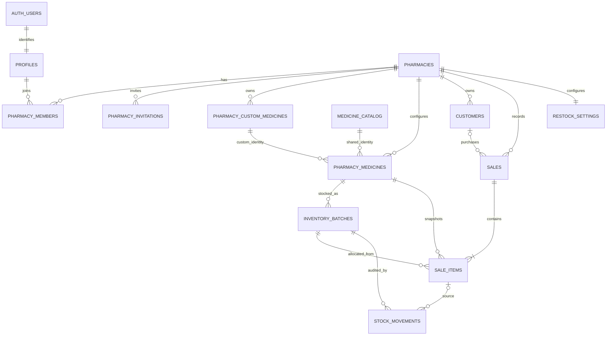

# MediSync database design — Phase 3A draft

**Status: design only.** The draft migrations were applied only to a disposable
local PostgreSQL 16 database during Phase 3A.2 validation. They have not been
applied to Supabase, staging, or production; see
[`validation/phase-3a2-local-validation.md`](./validation/phase-3a2-local-validation.md).
Nothing in `public` was changed; the legacy `public.pharmacies` and
`public.refills` tables remain untouched. The active application remains
demo-only.

## Architecture

All business tables are in the dedicated `medisync` schema. The separate
`medisync_private` schema contains only RLS predicate helpers and must not be
added to Supabase's exposed API schemas. `auth.users` remains the identity
provider; `medisync.profiles` adds MediSync display information without
replacing the Supabase identity.

`medicine_catalog` is shared and curated. Pharmacy-entered custom identities
live in `pharmacy_custom_medicines`, so a composite foreign key can prove that
the custom identity belongs to the same pharmacy as its inventory record.
There is deliberately no uniqueness constraint on the descriptive medicine
fields; similar names are not automatically merged.

### ER diagram

### Tables and key columns

| Table | Purpose and important columns |
|---|---|
| `pharmacies` | Tenant root: `id` (tenant UUID), `name`, optional `registration_number`, `phone_e164`, `address`, `created_by`, `created_at`, `updated_at`, `archived_at`. The root `id` is the pharmacy key; it does not repeat `pharmacy_id`. |
| `profiles` | User identity extension: `id` (same UUID as `auth.users`), `display_name`, optional `phone_e164`, `created_at`, `updated_at`. |
| `pharmacy_members` | Membership: `pharmacy_id`, `user_id`, `role`, `status`, optional same-pharmacy `invited_by`, `created_at`, `updated_at`; primary key is `(pharmacy_id,user_id)`. |
| `pharmacy_invitations` | `id`, `pharmacy_id`, `invited_email`, non-owner `role`, `status`, `token_hash`, `invited_by`, optional `accepted_by`, `expires_at`, optional `accepted_at`/`revoked_at`, `created_at`. |
| `medicine_catalog` | Shared curated identity: `id`, `brand_name`, `generic_name`, `composition`, `strength`, `dosage_form`, `pack_size`, `manufacturer`, `created_at`, `updated_at`. |
| `pharmacy_custom_medicines` | Same identity fields as the shared catalogue, plus tenant `id`, `pharmacy_id`, `created_by`, `created_at`, `updated_at`. |
| `pharmacy_medicines` | Tenant setup: `id`, `pharmacy_id`, exactly one of `catalog_medicine_id`/`custom_medicine_id`, optional `sku`, `selling_price_paise`, `tax_rate_bps`, `reorder_threshold`, `is_active`, `created_by`, `created_at`, `updated_at`. |
| `inventory_batches` | `id`, `pharmacy_id`, `pharmacy_medicine_id`, `batch_number`, `quantity_received`, `available_quantity`, `expiry_date`, `purchase_price_paise`, optional `mrp_paise`, optional `selling_price_override_paise`, `received_date`, `received_by`, `created_at`, `updated_at`. |
| `customers` | Tenant customer: `id`, `pharmacy_id`, `display_name`, optional `phone_e164`, `email`, `notes`, `created_by`, `created_at`, `updated_at`. |
| `sales` | `id`, `pharmacy_id`, `receipt_number`, optional `customer_id`, `status`, `currency_code`, `subtotal_paise`, `tax_paise`, `total_paise`, `idempotency_key`, `request_fingerprint`, `created_by`, `created_at`, `updated_at`. |
| `sale_items` | `id`, `pharmacy_id`, `sale_id`, `pharmacy_medicine_id`, `inventory_batch_id`, brand/product/batch snapshots, `quantity`, `unit_price_paise`, line subtotal, tax rate/amount, line total, `created_at`. |
| `stock_movements` | `id`, `pharmacy_id`, `pharmacy_medicine_id`, `inventory_batch_id`, `movement_type`, signed `quantity_delta`, `available_quantity_after`, optional `unit_cost_paise`, `request_id`, optional `source_sale_item_id`/`note`, `created_by`, `created_at`. |
| `restock_settings` | `pharmacy_id` (also primary key), `currency_code`, `time_zone`, `expiry_warning_days`, `default_reorder_threshold`, `default_tax_rate_bps`, `created_at`, `updated_at`. |

All pharmacy-owned tables carry `pharmacy_id`. `profiles` and the shared
`medicine_catalog` are intentionally global identity/catalogue records, not
tenant business records.

## Role-permission matrix

| Operation | Owner | Admin | Pharmacist | Cashier |
|---|---:|---:|---:|---:|
| Read pharmacy, catalogue and inventory | Yes | Yes | Yes | Yes |
| Edit pharmacy settings and restock defaults | Yes | Yes | No | No |
| Invite, suspend and manage staff | Yes | Yes | No | No |
| Transfer or remove the owner | Yes, controlled transfer only | No | No | No |
| Create custom medicines and pharmacy SKUs | Yes | Yes | Yes | No |
| Receive stock, adjust stock, record expiry/damage | Yes | Yes | Yes | No |
| Create customers and complete sales | Yes | Yes | Yes | Yes |
| View sales and receipts | Yes | Yes | Yes | Yes |
| Process returns or void a completed sale | Yes | Yes | Yes | No |
| Read stock movement history | Yes | Yes | Yes | No |

This is the proposed initial policy, not production authorization. Each write
permission must be enforced by an RPC/server operation and its database checks;
the Phase 1 role preview is not a security control.

## Tenant isolation and authorization

1. Resolve the caller from `auth.uid()`, never from an owner/user ID supplied by
   the browser.
2. Treat the requested active pharmacy ID as a selector only. Before any
   operation, verify an active `(pharmacy_id, auth.uid())` membership and the
   role required for that operation.
3. RLS filters every tenant-owned read by that active membership (or by the
   narrower role policy for invitations and restock settings).
4. Composite foreign keys include `pharmacy_id`: batches must reference a
   medicine configuration in the same pharmacy; sale items must reference a
   sale, medicine and batch in the same pharmacy; customer references are also
   tenant-scoped. This blocks cross-tenant links even if an application query
   is wrong.
5. Membership revocation changes the row to `suspended` (or removes it only
   after retention checks). Subsequent RLS and RPC checks reject the user.
   Never cache authorization as a long-lived browser claim.
6. The partial unique index allows at most one active owner. A transaction must
   also prevent the pharmacy from having zero active owners during transfer or
   suspension; a unique index alone cannot enforce that invariant.

`002_rls_and_privileges.sql` grants authenticated users only `SELECT`; it
defines no client-side `INSERT`, `UPDATE` or `DELETE` policy. Business writes
are reserved for narrowly-scoped operations added in the transaction phase.
Profiles are directly readable only by their owner; a staff roster that includes
other users' profile fields must be returned by a role-checked RPC with a
deliberate field allowlist.
The RLS helper functions are `SECURITY DEFINER`, have a fixed
`search_path = pg_catalog`, fully qualify referenced objects, and reveal only a
membership/role boolean. Their schema is not to be exposed through PostgREST.
Review the actual function owner and grants during staging deployment; never
add dynamic SQL or accept caller identity as a function argument.

The Supabase `service_role` bypasses RLS. It must not be sent to a browser,
committed, or used as a substitute for caller-aware authorization. Prefer
authenticated RPC calls that verify `auth.uid()` and tenant membership.

## Invitation handling

- Only owner/admin operations may create, list, revoke or accept invitations.
- Generate a high-entropy one-time raw token in trusted server code; store only
  its lowercase SHA-256 hex digest in `token_hash`. Return/send the raw token
  once and never log it. Do not select the hash from the API.
- Acceptance must hash the submitted token, lock the pending invitation,
  verify expiry and the authenticated email, insert the membership, and mark
  the invitation accepted in one transaction. Reject owner invitations.
- Email delivery, rate limits, resend behavior and abuse monitoring are
  application responsibilities. Never authorize acceptance using only a URL
  pharmacy ID or email supplied by the browser.

## Stock ledger and transaction design

Batch quantities are operational balances; `stock_movements` is the audit
ledger. `available_quantity` may exceed the original `quantity_received` after
a positive physical-count adjustment, so it is only constrained to be
non-negative. Authenticated clients receive no direct write grants on either table.
Each future write operation must update the batch and append its movement in
the same database transaction. A committed movement is never edited or deleted;
corrections use compensating movements.

The transaction layer must preserve
`available_quantity = opening/receipt movements + all later signed movements`
for each batch, and periodically reconcile that invariant from the ledger.

**Receiving stock**

1. Verify `owner`, `admin`, or `pharmacist` membership.
2. Require a caller-generated idempotency key and validate positive integer
   quantity, paise prices, date, pharmacy medicine ownership and batch fields.
3. Lock an existing same-pharmacy batch by `(pharmacy_medicine_id,batch_number)`
   or create it. If an existing batch's expiry or prices conflict, reject
   instead of silently merging. If two first receipts race to create the same
   batch, let the unique key choose one, then re-read/lock and validate the
   winner before applying the retry.
4. Increase `quantity_received` and `available_quantity`, append a positive
   `purchase` movement with the resulting balance and request ID, then commit.
   A retry with the same request ID returns the prior result without another
   stock increase.

**Sale and FEFO**

1. Verify active pharmacy membership and role; require an idempotency key and
   canonical request fingerprint. A replay with a different payload is rejected.
2. Combine duplicate requested medicine lines, then in one transaction lock
   eligible batches in sorted pharmacy-medicine ID order using `SELECT ...
   FOR UPDATE`; within each medicine order by expiry date, received date, then
   batch number. Use the pharmacy's `Asia/Kolkata` business date; exclude
   `expiry_date < business_date` and `available_quantity <= 0`.
3. Validate complete requested quantities before committing any changes.
   Allocate in FEFO order, calculate prices/tax using integer paise, insert the
   sale and batch-specific sale items with immutable display snapshots.
4. Decrement each allocated batch and insert a negative `sale` movement linked
   to its sale item. Save totals and receipt number, then commit. Any failure
   rolls back the sale, items, balance updates and movements together.
5. Row locks serialize competing sales for the same batches. Re-read quantities
   after locks; return a clear insufficient-stock error rather than a partial
   sale. Keep a consistent lock order (pharmacy medicine, then expiry-sorted
   batches) to reduce deadlocks and retry deadlock/serialization failures with
   the same idempotency key.

A committed sale is not rolled back by deleting rows. A return/void is a
separate authorized transaction with compensating `sale_return` movements,
return-quantity checks, and an updated sale status. `expired` and `damaged`
movements decrement stock and retain the original batch history.

## Proposed rollout after approval

1. Create/use the separate MediSync staging Supabase project and verify its
   PostgreSQL version, API schema exposure and migration owner.
2. Apply the numbered drafts only to staging after code review; do not copy any
   Refill Saathi rows into these tables as part of this phase.
3. Test with two pharmacies and users in both: anonymous access, member reads,
   cross-pharmacy IDs, custom-medicine FKs, suspended-member revocation,
   invitation token visibility, direct DML denial, and role-specific reads.
4. Add and test the narrowly-scoped transaction RPCs before any UI write path.
   Production rollout requires separate approval, backup/restore planning and
   an explicit migration window.

## Frontend-to-database mapping

| Current Phase 2 type/field | Proposed database mapping | Integration note |
|---|---|---|
| `Medicine` | `medicine_catalog` or `pharmacy_custom_medicines` | Add a source discriminator and use UUID IDs. A custom identity is tenant-scoped. |
| `brandName`, `genericName`, `composition`, `strength`, `dosageForm`, `packSize`, `manufacturer` | Same-named snake_case identity columns | Keep these descriptive values; do not infer identity or merge by text. |
| `PharmacyMedicine.pharmacyId`, `medicineId`, `sku`, `sellingPricePaise`, `reorderThreshold` | `pharmacy_medicines.pharmacy_id`, identity FK, `sku`, `selling_price_paise`, `reorder_threshold` | Model the identity FK as shared-catalog ID or custom ID. Backend UUIDs replace demo slugs. |
| `InventoryBatch.pharmacyMedicineId`, `batchNumber`, `quantityReceived`, `availableQuantity`, `expiryDate`, `purchasePricePaise`, `mrpPaise`, `receivedDate` | `inventory_batches` corresponding columns | Add optional `sellingPriceOverridePaise` and `receivedBy`. Never update `availableQuantity` directly from the UI. |
| `pharmacyId` on batches | `inventory_batches.pharmacy_id` plus composite FK | Keep the pharmacy ID in queries, but do not treat it as authorization. |
| Customers, sales, sale items and stock movements | New typed models mapped to corresponding tables | Sale items and receipt display fields must be snapshots, not live joins only. |
| `formatINR(number)` and `*Paise: number` | PostgreSQL `bigint` integer paise | JSON/JavaScript numbers cannot exactly represent every `int8`. Use a validated decimal-string/BigInt boundary or enforce safe integer limits; never cast blindly to JS `number`. |
| `DEMO_TODAY = "2026-11-17"` | Per-request business date derived from `time_zone` | Keep the fixed date only in demo data. Production expiry and sales logic must not use it. |
| `DEMO_EXPIRY_WARNING_DAYS = 30` | `restock_settings.expiry_warning_days` | Fetch per active pharmacy; default remains 30 days. |
| `imageUrl` | Not included in this SQL draft | Add a separately authorized Storage bucket/path policy only when image upload is implemented. |

The `InventoryBatch` frontend type currently stores `availableQuantity` for
demo calculations. Production UI should receive it read-only from the backend
and only trigger receiving/sale/adjustment operations. The schema also adds a
batch-level selling-price override to match the confirmed pricing decision;
Phase 2 currently models only the pharmacy default selling price and batch MRP.

## Risks and decisions still needed

- Confirm GST behavior: tax-inclusive versus tax-exclusive prices, rate selection,
  rounding rule, and whether tax rate belongs to medicine, pharmacy, or both.
  The draft stores basis-point snapshots but does not calculate tax.
- Define the sellable quantity unit (individual tablet, strip, bottle, etc.) and
  pack conversion rules before production billing. Current mock data does not
  define conversions.
- Decide how pharmacy registration/licence details are validated and who can
  edit them.
- Decide invitation email delivery, token expiry, resend/rate-limit policy and
  whether invitations may target an email not yet registered.
- Define owner transfer, account deletion, data retention and hard-purge policy.
  Foreign keys intentionally restrict deleting operational history.
- Decide whether a sale can span multiple batches as separate receipt lines,
  how returns are approved, and whether sales can be partially returned.
- Decide whether purchase vendors/receipts are needed. This draft records
  receiving as a `purchase` stock movement and does not model suppliers or
  purchase invoices.
- Define who may view customer phone/notes and how long those records are kept.
- Decide whether a phone number may belong to multiple customer profiles. The
  draft indexes phone numbers for lookup but intentionally does not make them
  unique, since family members may share one number.
- Validate the curated catalogue source and moderation process. No external
  medicine API or automatic matching is assumed.
- Confirm PostgREST exposes `medisync` only after review; do not expose
  `medisync_private`. Existing `public` legacy data remains separate and unmigrated.

## Review checklist

- Both SQL files are drafts only. They were reviewed by inspection for schema
  qualification, enum values, FK target uniqueness, matching column order,
  RLS coverage, and privilege intent.
- Phase 3A.2 also applied the migrations to a disposable local PostgreSQL
  database and ran the checks in the linked validation report. This does not
  validate the real Supabase platform or replace staging tests after approval.
- Before staging use, review the Supabase PostgreSQL version, schema exposure,
  migration owner, grants/default privileges, security-definer ownership,
  PostgREST handling of column-level invitation grants, and actual RLS behavior.
